<p align="right"><a href="README.md">Русский</a> · <b>English</b></p>

<p align="center">
  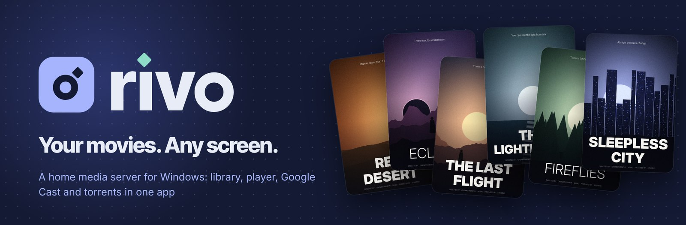
</p>

<p align="center">
  <a href="https://github.com/thirteenbtw/Rivo/actions/workflows/build.yml"></a>
  <a href="https://github.com/thirteenbtw/Rivo/releases/latest"></a>
  
  
  
  
  
</p>

<p align="center">
  <b>Rivo</b> is a home cinema for Windows. It turns the movies and shows on your drives into a beautiful library,<br>
  plays them in its own player, sends them to your TV and can stream torrents while they download.
</p>

<p align="center">
  <a href="https://github.com/thirteenbtw/Rivo/releases/latest"><b>Download</b></a> ·
  <a href="#features">Features</a> ·
  <a href="#screenshots">Screenshots</a> ·
  <a href="#development">Development</a> ·
  <a href="README.md">Русский</a>
</p>

<p align="center">
  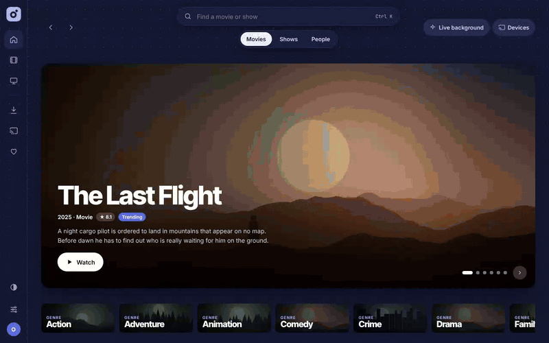
</p>

## Features

<table>
<tr>
<td width="50%" valign="top">

### 🎬 Library
Point Rivo at your folders and it finds movies and shows by itself, understands names like `Title.2014.1080p`, `S01E02` or "Season 1 / Episode 2", and pulls posters, descriptions and cast from TMDB. New files show up on their own, and an unplugged drive doesn't wipe its entries.

</td>
<td width="50%" valign="top">

### ▶️ Player
Direct play, or on-the-fly transcoding with hardware acceleration (NVENC, Quick Sync, AMF). HDR → SDR, audio track choice, SRT/ASS/VTT subtitles with offset, keyboard shortcuts, auto-play of the next episode.

</td>
</tr>
<tr>
<td valign="top">

### 📺 To the TV
Finds Google Cast devices on your network and works as a remote: pause, seek, volume, switching tracks. The watch position is shared between PC and TV, so you can start on one and finish on the other.

</td>
<td valign="top">

### 🧲 Torrents
Magnet links and `.torrent` files, a "Watch now" mode with sequential download, queue, speed limits, schedule. Binding to a VPN with a kill switch. Finished downloads move into the library by themselves.

</td>
</tr>
<tr>
<td valign="top">

### 🔎 Catalog
Trending titles, new releases, genre collections and people pages. A title page lists releases from your own sources (JacRed, Jackett, Prowlarr), with the best one highlighted.

</td>
<td valign="top">

### 👥 For the whole family
Up to five profiles with a PIN, their own theme and history. Light, dark and OLED themes, a "live" background. The UI also opens on a phone: `http://<PC IP>:8096`.

</td>
</tr>
</table>

## Screenshots

<table>
<tr>
<td width="50%">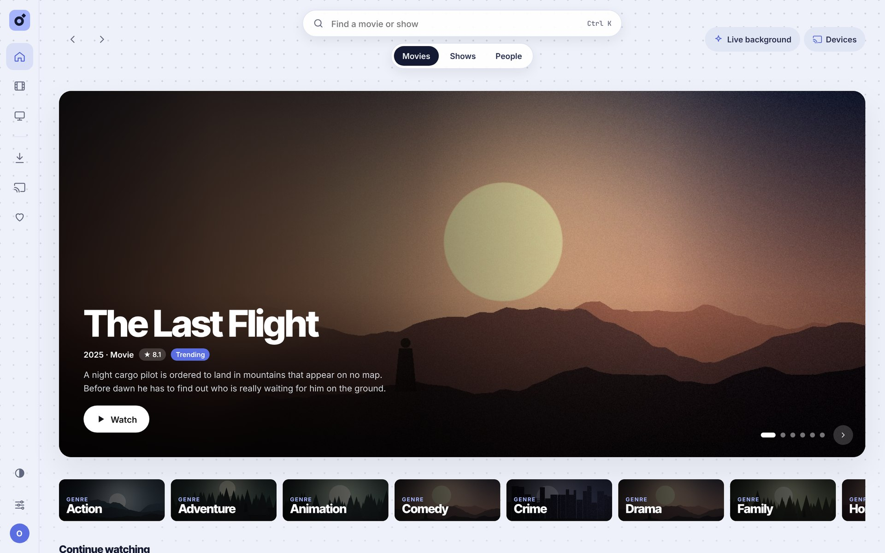<p align="center"><sub>Home: trending and "Continue watching"</sub></p></td>
<td width="50%">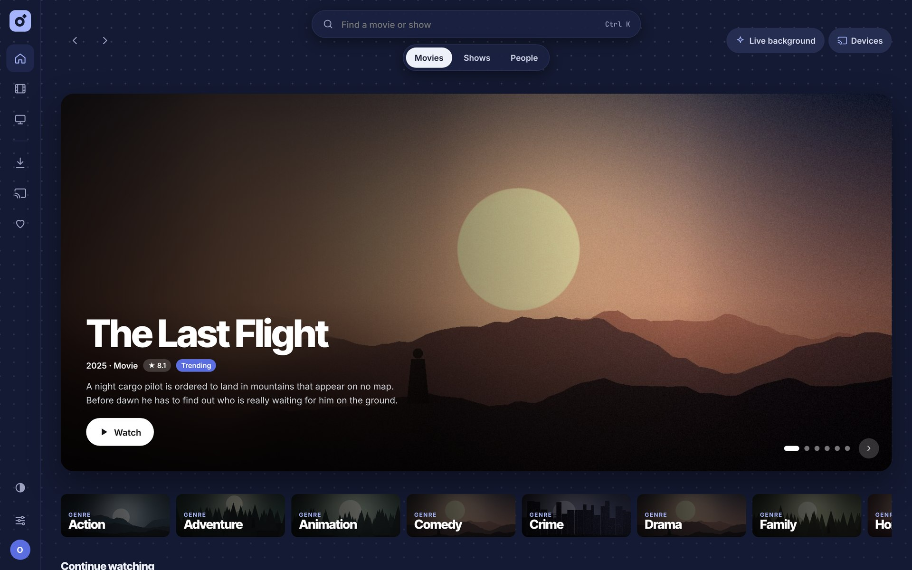<p align="center"><sub>The same home screen in the dark theme</sub></p></td>
</tr>
<tr>
<td>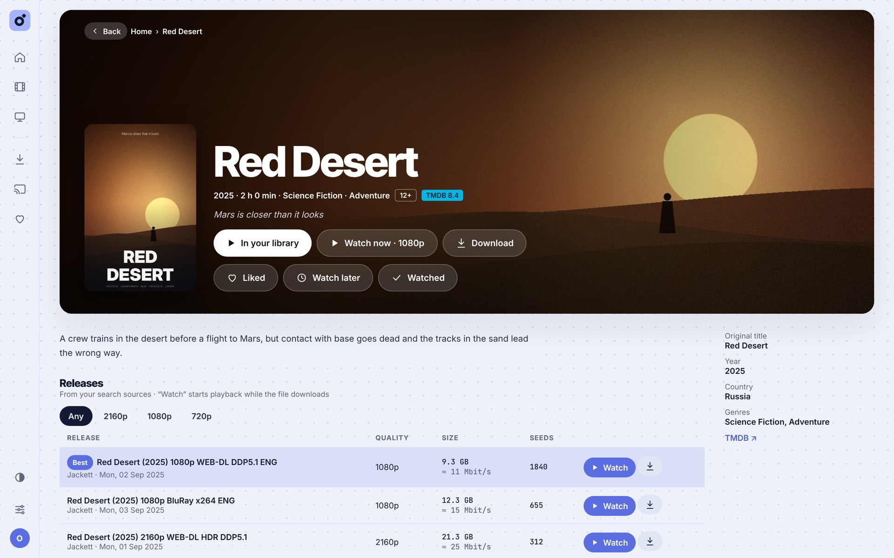<p align="center"><sub>Movie: play from the library or straight from a release</sub></p></td>
<td>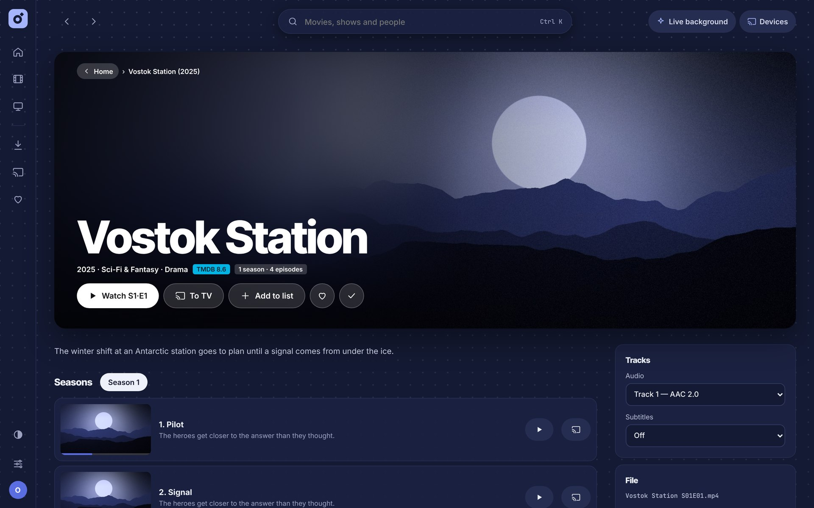<p align="center"><sub>Show: seasons, episodes, audio and subtitles</sub></p></td>
</tr>
<tr>
<td>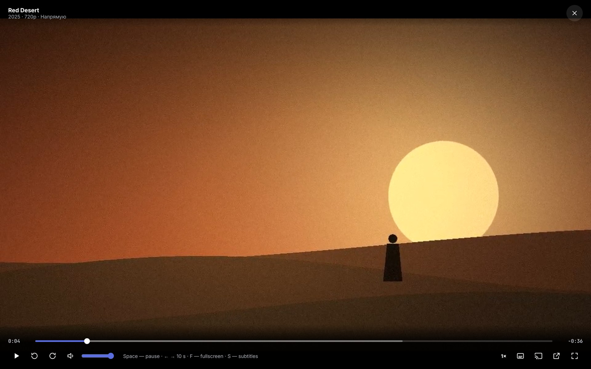<p align="center"><sub>Player</sub></p></td>
<td>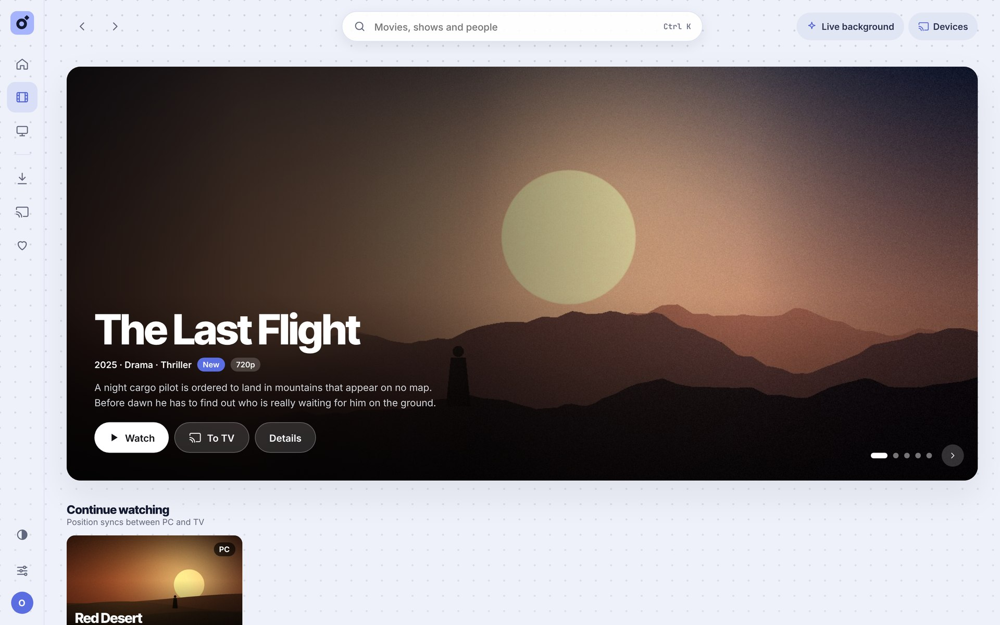<p align="center"><sub>The library from your drives</sub></p></td>
</tr>
<tr>
<td>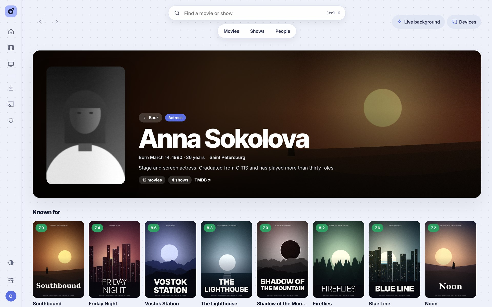<p align="center"><sub>Person page</sub></p></td>
<td>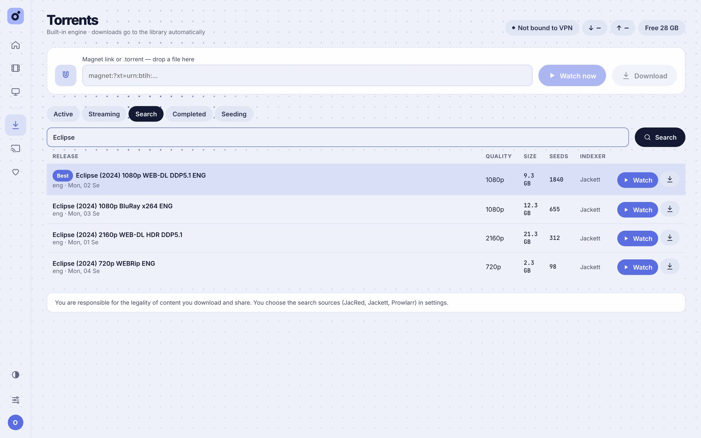<p align="center"><sub>Release search</sub></p></td>
</tr>
<tr>
<td>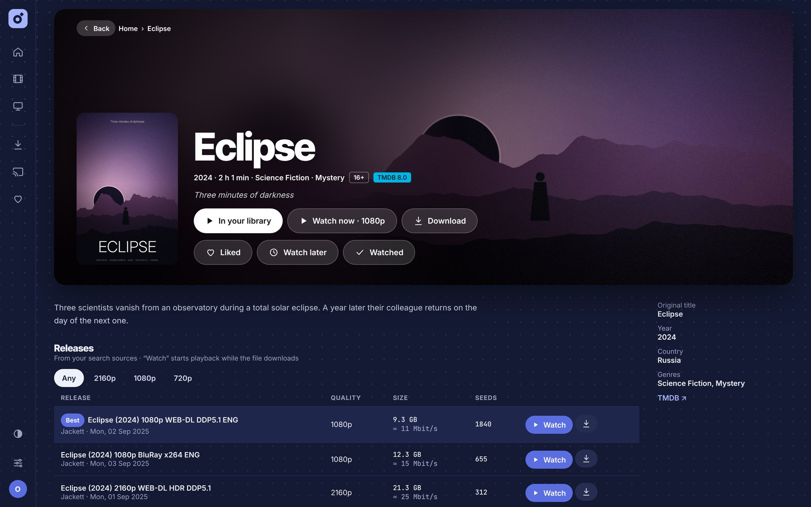<p align="center"><sub>Releases with quality, size and seeds</sub></p></td>
<td>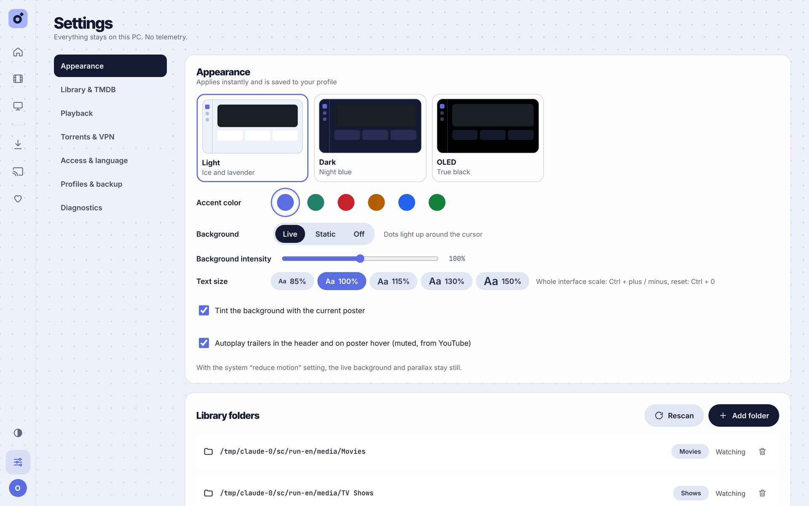<p align="center"><sub>Settings: themes, accents, folders</sub></p></td>
</tr>
</table>

<sub>The movies, posters and people in the screenshots are made up and drawn for the demo; in the real app the data comes from TMDB.</sub>

## Install

1. Download the installer [**Rivo_&lt;version&gt;_x64-setup.exe**](https://github.com/thirteenbtw/Rivo/releases/latest) from the latest release.
   The newest build from `main` is in [Actions](https://github.com/thirteenbtw/Rivo/actions/workflows/build.yml): the `Rivo-windows-installer` artifact of the latest green run (requires signing in to GitHub).
2. Run the installer. It installs the server, the player and FFmpeg, and opens the port in the Windows firewall for private networks only.
3. On first launch, pick your movie and show folders. Rivo does the rest.

Rivo works only inside your local network and sends nothing anywhere apart from the update check described below. Its data lives in `%APPDATA%\HomeCinema` (the folder keeps the app's former name so that updating doesn't lose the library). If an old HomeCinema install is present, the installer removes it.

After that Rivo updates itself. Every few hours it asks GitHub whether a new release is out, downloads the signed installer in the background and offers to restart into it, with a card in the window and an item in the tray menu. When Rivo was started with Windows and sits in the tray, the update goes in right away. The signature is checked against a key built into the app, so a tampered installer is refused. The tray menu (in Russian for now) has «Обновляться автоматически» to turn the checks off and «Проверить обновления» to check on demand.

The interface language is Russian by default; switch it to English in Settings → Access & language.

## How it works

| Part | Where | Stack |
|---|---|---|
| Media server | [`server/`](server) | Go, SQLite (no cgo), ffmpeg/ffprobe, anacrolix/torrent, go-chromecast |
| Interface | [`web/`](web) | React 18 + TypeScript + Vite, hls.js |
| Windows shell | [`desktop/`](desktop) | Tauri 2: window, tray, autostart, magnet links, NSIS installer |

The interface is embedded in the server binary, so the same UI opens in a phone's or TV's browser.

<details>
<summary><b>All features in detail</b></summary>

- **Library.** Folders are watched (fsnotify plus a rescan every 30 minutes); names like `Title.2014.1080p`, `S01E02`, `1x02`, "Сезон 1 / Серия 2" are parsed. Metadata, posters and cast come from TMDB (a v3 key or v4 token, or through mirrors), and a wrong match can be fixed by hand. An unplugged drive doesn't wipe its entries.
- **Player.** Direct play with Range requests, or HLS transcoding through ffmpeg with hardware acceleration (NVENC / Quick Sync / AMF / VAAPI, otherwise CPU), HDR → SDR tone mapping, audio track choice, SRT/ASS/VTT subtitles (external and embedded, CP1251 detected) with offset; PGS/VobSub are burned in. Keyboard shortcuts, playback speed, auto-play of the next episode, external VLC/mpv player.
- **Watch position** syncs between PC and TV; "Continue watching", favourites, "Watch later", "watched" marks.
- **TV.** Google Cast discovery over mDNS, adding a device by IP, a remote: pause, seek, volume, track switching, "Continue on PC". Players sit behind a `Renderer` interface, so DLNA/AirPlay can be added as separate implementations.
- **Torrents.** Magnet / `.torrent` (drag and drop too), "Watch now" with sequential download and a buffer, piece map, queue, priorities, speed limits, schedule, seeding up to a ratio or time, free space checks. Binding to a VPN interface with a kill switch, SOCKS5 proxy, encryption. Finished downloads are moved into the library as `Title (Year)/…` and `Show/Season N/…`. Executable files from torrents are blocked. Search only uses sources the user picks (JacRed, Jackett / Prowlarr via Torznab).
- **Profiles** (up to 5) with a PIN, their own theme and history. Themes: light, dark, OLED; several accent colours; a "live" background.
- **Security.** The server answers only local network addresses, with an optional password for other devices (never asked on the PC itself). TVs get links with signed tokens valid for 6 hours.
- **Maintenance.** Database backup and restore, CSV export of watch history, diagnostics (ffmpeg, network, TV, TMDB, torrent port, VPN, disk), log.
- **Languages:** Russian and English.

</details>

## Development

You need Go 1.26+, Node 20+ and ffmpeg in `PATH`; the Windows shell also needs Rust and WebView2.

```bash
# server (API on :8096)
cd server && go run ./cmd/homecinema -dev -data ./devdata

# interface with hot reload (proxies /api → :8096)
cd web && npm ci && npm run dev

# build the UI into the server, run tests
cd web && npm run build
cd server && go test ./... && go build ./cmd/homecinema
```

<details>
<summary>Building the Windows shell, server flags</summary>

```bash
# put the binaries in place with the target triple suffix:
#   desktop/src-tauri/binaries/rivo-server-x86_64-pc-windows-msvc.exe
#   desktop/src-tauri/binaries/ffmpeg-x86_64-pc-windows-msvc.exe
#   desktop/src-tauri/binaries/ffprobe-x86_64-pc-windows-msvc.exe
cd desktop && npm ci && npx tauri build
```

GitHub Actions ([`.github/workflows/build.yml`](.github/workflows/build.yml)) builds the installer on `windows-latest`: a `Rivo-windows-installer` artifact on every run, and a release with the `.exe` when a `v*` tag is pushed. The installer ships the server and an LGPL FFmpeg build (BtbN) next to the app.

Server flags: `-data`, `-listen` (default `0.0.0.0:8096`; if the port is taken it tries the next ones), `-ffmpeg`, `-ffprobe`, `-dev`, `-exit-on-stdin-close` (for the shell). When the server is ready it prints `HOMECINEMA_READY http://127.0.0.1:<port>`, and the shell opens its window on that line.

The README screenshots and GIF are made by [`tools/demo`](tools/demo): it runs the real app against a fake TMDB with a fictional catalog (`DEMO_LANG=en tools/demo/run.sh` for the English set).

</details>

<details>
<summary>Brand</summary>

Palette: lavender `#A5B4FC` (brand), ice `#E7ECF7` (background), iris `#5B6EE1` (actions), mint `#8EDCC8` (accents, progress), night `#141A33` (text, dark theme). Headlines in Inter Tight 800–900, UI in Inter. The symbol is a ring with a tilted square spark; the wordmark is «rıvo». App icons are generated from `desktop/app-icon.png` (`npm run icons` in `desktop/`); the source is `desktop/app-icon.svg`.

</details>

<details>
<summary>What has been tested and what hasn't</summary>

Tested in a Linux container: scanning and name parsing (unit tests), direct play and HLS transcoding of HEVC 10-bit on the CPU in a browser, external subtitles, adding a torrent, seeding and auto-import into the library, every screen of the UI. The Rust shell passes `cargo check` for `x86_64-pc-windows-msvc`.

Not tested live: requests to the real TMDB, casting to a real Chromecast, hardware encoders, VPN binding on Windows, the built installer.

</details>

## Licenses and responsibility

FFmpeg ships as an LGPL build in separate `ffmpeg.exe` / `ffprobe.exe` files. Movie data comes from [TMDB](https://www.themoviedb.org/); Rivo is not endorsed or certified by TMDB. You are responsible for the legality of what you download and share over torrents; the app comes with no content of its own.

<p align="center"><a href="README.md">Читать на русском →</a></p>
