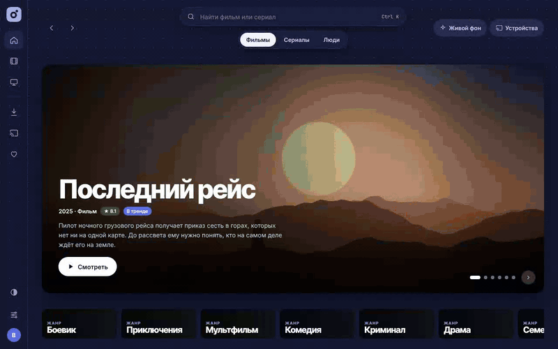
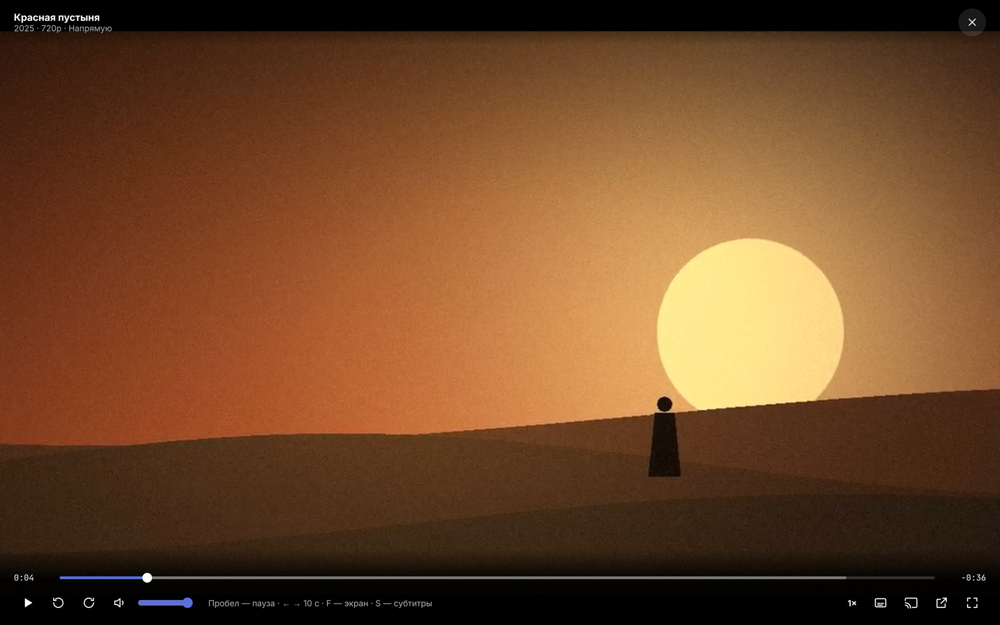
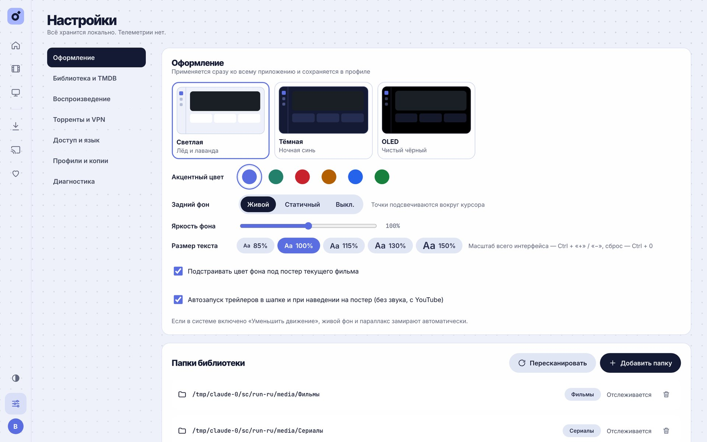

<p align="right"><b>Русский</b> · <a href="README.en.md">English</a></p>

<p align="center">
  
</p>

<p align="center">
  <a href="https://github.com/thirteenbtw/Rivo/actions/workflows/build.yml"></a>
  <a href="https://github.com/thirteenbtw/Rivo/releases/latest"></a>
  
  
  
  
  
</p>

<p align="center">
  <b>Rivo</b> — домашний кинотеатр для Windows. Собирает фильмы и сериалы с ваших дисков в красивую библиотеку,<br>
  играет их в своём плеере, отправляет на телевизор и умеет смотреть торренты, пока они качаются.
</p>

<p align="center">
  <a href="https://github.com/thirteenbtw/Rivo/releases/latest"><b>Скачать</b></a> ·
  <a href="#возможности">Возможности</a> ·
  <a href="#скриншоты">Скриншоты</a> ·
  <a href="#разработка">Разработка</a> ·
  <a href="README.en.md">English</a>
</p>

<p align="center">
  
</p>

## Возможности

<table>
<tr>
<td width="50%" valign="top">

### 🎬 Библиотека
Укажите папки — Rivo сам найдёт фильмы и сериалы, разберёт имена вида `Title.2014.1080p`, `S01E02` или «Сезон 1 / Серия 2», подтянет постеры, описания и актёров из TMDB. Новые файлы появляются сами, отключённый диск не стирает записи.

</td>
<td width="50%" valign="top">

### ▶️ Плеер
Прямое воспроизведение или транскод на лету с аппаратным ускорением (NVENC, Quick Sync, AMF). HDR → SDR, выбор дорожки, субтитры SRT/ASS/VTT со сдвигом, горячие клавиши, автопереход к следующей серии.

</td>
</tr>
<tr>
<td valign="top">

### 📺 На телевизор
Находит Google Cast устройства в сети, работает как пульт: пауза, перемотка, громкость, смена дорожек. Позиция просмотра общая для ПК и ТВ — начали на одном, продолжили на другом.

</td>
<td valign="top">

### 🧲 Торренты
Magnet и `.torrent`, режим «Смотреть сразу» с последовательной загрузкой, очередь, лимиты, расписание. Привязка к VPN с kill switch. Готовое само переезжает в библиотеку.

</td>
</tr>
<tr>
<td valign="top">

### 🔎 Каталог
Тренды, новинки, подборки по жанрам и страницы актёров. На странице фильма — раздачи из ваших источников (JacRed, Jackett, Prowlarr), лучшая подсвечена.

</td>
<td valign="top">

### 👥 Для всей семьи
До пяти профилей с PIN, своей темой и историей. Светлая, тёмная и OLED-темы, «живой» фон. Интерфейс открывается и с телефона: `http://<IP ПК>:8096`.

</td>
</tr>
</table>

## Скриншоты

<table>
<tr>
<td width="50%"><p align="center"><sub>Главная: тренды и «Продолжить просмотр»</sub></p></td>
<td width="50%"><p align="center"><sub>Та же главная в тёмной теме</sub></p></td>
</tr>
<tr>
<td><p align="center"><sub>Фильм: смотреть из библиотеки или сразу из раздачи</sub></p></td>
<td><p align="center"><sub>Сериал: сезоны, серии, дорожки и субтитры</sub></p></td>
</tr>
<tr>
<td><p align="center"><sub>Плеер</sub></p></td>
<td><p align="center"><sub>Библиотека с ваших дисков</sub></p></td>
</tr>
<tr>
<td><p align="center"><sub>Страница актёра</sub></p></td>
<td><p align="center"><sub>Поиск раздач</sub></p></td>
</tr>
<tr>
<td><p align="center"><sub>Раздачи с качеством, размером и сидами</sub></p></td>
<td><p align="center"><sub>Настройки: темы, акценты, папки</sub></p></td>
</tr>
</table>

<sub>Фильмы, постеры и люди на скриншотах выдуманы и нарисованы для демонстрации; в настоящем приложении данные приходят из TMDB.</sub>

## Установка

1. Скачайте установщик [**Rivo_<версия>_x64-setup.exe**](https://github.com/thirteenbtw/Rivo/releases/latest) со страницы последнего релиза.
   Самая свежая сборка из `main` лежит в [Actions](https://github.com/thirteenbtw/Rivo/actions/workflows/build.yml): артефакт `Rivo-windows-installer` у последнего зелёного запуска (нужен вход в GitHub).
2. Запустите установщик. Он ставит сервер, плеер и FFmpeg, а также открывает порт в брандмауэре только для частных сетей.
3. При первом запуске укажите папки с фильмами и сериалами. Всё остальное Rivo сделает сам.

Rivo работает только в вашей локальной сети и ничего никуда не отправляет, кроме проверки обновлений (о ней ниже). Данные хранятся в `%APPDATA%\HomeCinema` (имя папки осталось от прежнего названия, чтобы обновление не потеряло библиотеку). Если стояла старая версия HomeCinema, установщик удалит её сам.

Дальше Rivo обновляется сам. Раз в несколько часов он спрашивает у GitHub, вышел ли новый релиз, скачивает подписанный установщик в фоне и предлагает перезапуститься: карточкой в окне или пунктом «Установить обновление» в трее. Если Rivo запущен вместе с Windows и свёрнут в трей, обновление ставится сразу. Подпись проверяется ключом, зашитым в приложение, так что чужой установщик не пройдёт. Автопроверку можно выключить в трее: «Обновляться автоматически»; «Проверить обновления» там же проверит вручную.

## Как это устроено

| Часть | Где | Технологии |
|---|---|---|
| Медиасервер | [`server/`](server) | Go, SQLite (без cgo), ffmpeg/ffprobe, anacrolix/torrent, go-chromecast |
| Интерфейс | [`web/`](web) | React 18 + TypeScript + Vite, hls.js |
| Оболочка Windows | [`desktop/`](desktop) | Tauri 2: окно, трей, автозапуск, magnet-ссылки, установщик NSIS |

Интерфейс встраивается в бинарник сервера, поэтому тот же UI открывается в браузере телефона или ТВ.

<details>
<summary><b>Все возможности подробно</b></summary>

- **Библиотека.** Папки отслеживаются (fsnotify + пересканирование раз в 30 минут), разбор имён вида `Title.2014.1080p`, `S01E02`, `1x02`, «Сезон 1 / Серия 2». Метаданные, постеры и актёры из TMDB (ключ v3 или токен v4, либо через зеркала), ручное исправление совпадения. Отключённый диск не стирает записи.
- **Плеер.** Прямое воспроизведение с Range, либо HLS-транскод через ffmpeg с аппаратным ускорением (NVENC / Quick Sync / AMF / VAAPI, иначе CPU), тонмаппинг HDR → SDR, выбор аудиодорожки, субтитры SRT/ASS/VTT (внешние и встроенные, CP1251 распознаётся) со сдвигом, PGS/VobSub вжигаются. Горячие клавиши, скорость, автопереход к следующей серии, внешний плеер VLC/mpv.
- **Позиция просмотра** синхронизируется между ПК и ТВ; «Продолжить просмотр», избранное, «Посмотреть позже», отметки «просмотрено».
- **ТВ.** Поиск Google Cast устройств по mDNS, добавление по IP, пульт: пауза, перемотка, громкость, смена дорожек, «Продолжить на ПК». Плееры подключены через интерфейс `Renderer`, DLNA/AirPlay добавляются отдельными реализациями.
- **Торренты.** Magnet / `.torrent` (в том числе перетаскиванием), «Смотреть сразу» с последовательной загрузкой и буфером, карта кусков, очередь, приоритеты, лимиты скорости, расписание, раздача до рейтинга/времени, контроль свободного места. Привязка к интерфейсу VPN с kill switch, SOCKS5-прокси, шифрование. Готовые загрузки переносятся в библиотеку как `Название (Год)/…` и `Сериал/Season N/…`. Исполняемые файлы из раздач блокируются. Поиск только по источникам, которые выбирает пользователь (JacRed, Jackett / Prowlarr через Torznab).
- **Профили** (до 5) с PIN, своей темой и историей. Темы: светлая, тёмная, OLED; несколько акцентных цветов; «живой» фон.
- **Безопасность.** Сервер отвечает только адресам локальной сети, по желанию пароль для других устройств (на самом ПК не спрашивается). ТВ получают ссылки с подписанными токенами на 6 часов.
- **Обслуживание.** Резервная копия и восстановление БД, экспорт просмотренного в CSV, диагностика (ffmpeg, сеть, ТВ, TMDB, порт торрентов, VPN, диск), журнал.
- **Языки:** русский и английский.

</details>

## Разработка

Нужны Go 1.26+, Node 20+, ffmpeg в `PATH`; для оболочки ещё Rust и WebView2.

```bash
# сервер (API на :8096)
cd server && go run ./cmd/homecinema -dev -data ./devdata

# интерфейс с hot reload (прокси /api → :8096)
cd web && npm ci && npm run dev

# сборка UI внутрь сервера и тесты
cd web && npm run build
cd server && go test ./... && go build ./cmd/homecinema
```

<details>
<summary>Сборка оболочки Windows и флаги сервера</summary>

```bash
# положите бинарники с суффиксом целевой платформы:
#   desktop/src-tauri/binaries/rivo-server-x86_64-pc-windows-msvc.exe
#   desktop/src-tauri/binaries/ffmpeg-x86_64-pc-windows-msvc.exe
#   desktop/src-tauri/binaries/ffprobe-x86_64-pc-windows-msvc.exe
cd desktop && npm ci && npx tauri build
```

Готовый установщик собирает GitHub Actions ([`.github/workflows/build.yml`](.github/workflows/build.yml)) на `windows-latest`: артефакт `Rivo-windows-installer` у каждого запуска, а при пуше тега `v*` — релиз с `.exe`. Установщик кладёт рядом сервер и LGPL-сборку FFmpeg (BtbN).

Флаги сервера: `-data`, `-listen` (по умолчанию `0.0.0.0:8096`, при занятом порте пробует следующие), `-ffmpeg`, `-ffprobe`, `-dev`, `-exit-on-stdin-close` (для оболочки). Когда сервер готов, он печатает `HOMECINEMA_READY http://127.0.0.1:<порт>` — по этой строке оболочка открывает окно.

Скриншоты и GIF для README делает [`tools/demo`](tools/demo): он запускает настоящее приложение с поддельным TMDB и выдуманным каталогом (`DEMO_LANG=en tools/demo/run.sh` — английский комплект).

</details>

<details>
<summary>Фирменный стиль</summary>

Палитра: лаванда `#A5B4FC` (бренд), лёд `#E7ECF7` (фон), ирис `#5B6EE1` (действия), мята `#8EDCC8` (акценты, прогресс), ночь `#141A33` (текст, тёмная тема). Заголовки — Inter Tight 800–900, интерфейс — Inter. Знак — кольцо с наклонённым квадратом-искрой, логотип — «rıvo». Иконки приложения собираются из `desktop/app-icon.png` (`npm run icons` в `desktop/`), исходник — `desktop/app-icon.svg`.

</details>

<details>
<summary>Что проверено, а что нет</summary>

Проверено в Linux-контейнере: сканирование и разбор имён (юнит-тесты), прямое воспроизведение и HLS-транскод HEVC 10-bit на CPU в браузере, внешние субтитры, добавление торрента, раздача и автоимпорт в библиотеку, все экраны интерфейса. Rust-оболочка проходит `cargo check` под `x86_64-pc-windows-msvc`.

Не проверено вживую: запросы к настоящему TMDB, трансляция на реальный Chromecast, аппаратные кодировщики, привязка к VPN на Windows, собранный установщик.

</details>

## Лицензии и ответственность

FFmpeg поставляется в LGPL-сборке как отдельные `ffmpeg.exe` / `ffprobe.exe`. Данные о фильмах — [TMDB](https://www.themoviedb.org/); Rivo не связан с TMDB и не одобрен ею. Ответственность за законность загружаемого и раздаваемого через торренты контента лежит на пользователе; в приложении нет встроенного контента.

<p align="center"><a href="README.en.md">Read this in English →</a></p>
